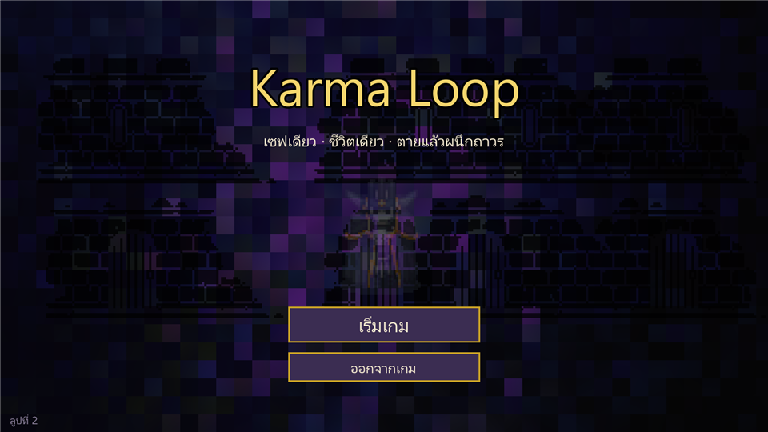
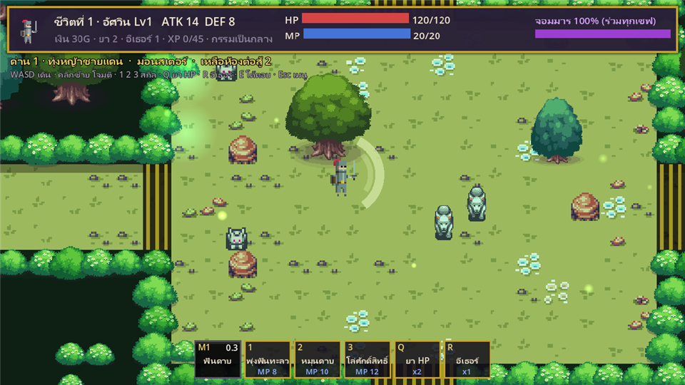
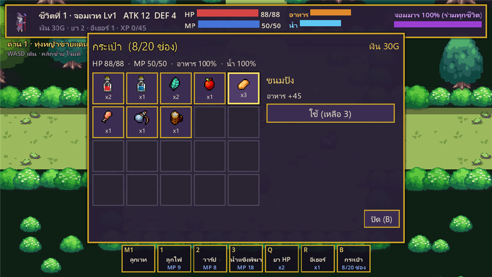
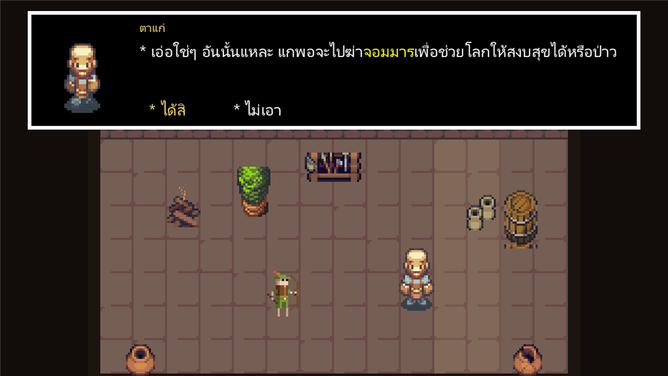
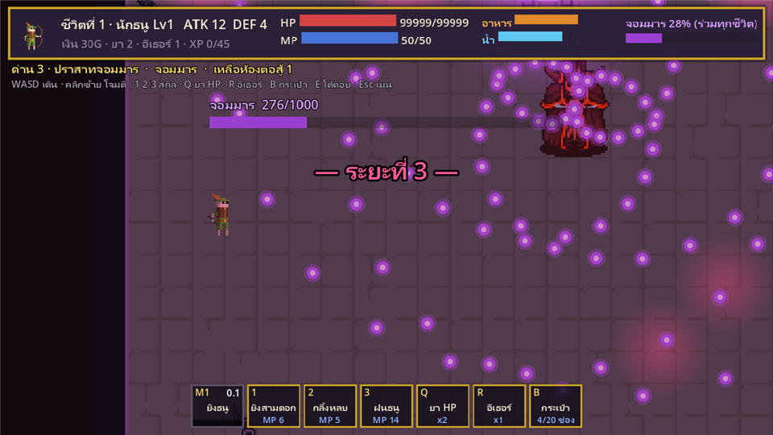

# Karma Loop



เกมแอ็กชัน RPG มุมมองบนลงล่าง (top-down) แบบ "ชีวิตเดียว เซฟเดียว" ทำด้วย **Godot 4.7.1** สำหรับงาน Isan Game Jam

---

## เกมนี้คืออะไร

คุณคือผู้กล้าที่ถูกส่งไปปราบจอมมาร แต่ทุกครั้งที่ตาย ชีวิตนั้นจะถูก "ผนึก" ถาวร และต้องเริ่มใหม่ในร่างผู้กล้าคนถัดไป
ความดีความชั่ว (กรรม) ที่ทำไว้จะติดตัวไปชาติหน้า ส่วนเลือดของจอมมารก็ลดลงสะสมข้ามทุกชีวิต
สู้ไปทีละชีวิต จนกว่าจะโค่นจอมมารได้... แล้วค่อยรู้ว่าวงจรนี้มันจบจริงหรือเปล่า

## จุดเด่น

- **3 ชีวิต 3 เซฟ แต่มีชีวิตอยู่ได้ทีละคน** ตายแล้วเซฟถูกผนึก ทิ้งหลุมศพไว้ให้ชีวิตถัดไปเก็บของ
- **กรรมข้ามชาติ** ทำดี ชาติหน้าเริ่มง่ายขึ้น ทำชั่ว ชาติหน้าเจอมอนเยอะขึ้น ฆ่าชาวบ้านได้ แต่จะติด "ตราบาป"
- **เลือดบอสร่วมกันทุกชีวิต** จอมมารมี 3 เฟส เฟสละหนึ่งหลอด เลือดที่ตีไปแล้วไม่หายแม้ผู้กล้าจะตาย
- **บอสเฟส 3 แบบ Windowkill** เกม "แครช" แล้วการต่อสู้หลุดออกมาเป็นหน้าต่างเล็กๆ บนเดสก์ท็อปจริงของคุณ
- **สู้แบบเรียลไทม์** เดิน WASD ฟัน/ยิงด้วยเมาส์ สกิล 3 ปุ่มต่ออาชีพ ปัดป้อง (Parry) สะท้อนกระสุน
- **แมพแตกแขนง** ห้องมอนสเตอร์ ร้านค้า เหตุการณ์สุ่ม เควสชาวบ้าน ของเก็บตามทาง หน้าตาแต่ละด่านต่างกัน
- **เอาชีวิตรอด** หลอดอาหารและน้ำแยกกัน ต้องกินจากกระเป๋า
- **คัตซีนสไตล์ Undertale** กล่องบทพูดพิมพ์ทีละตัว พร้อมตัวเลือกที่อาจทำให้เสียเซฟได้จริง

| | |
|---|---|
|  |  |
|  |  |

## เนื้อเรื่อง

ผู้เฒ่าในหมู่บ้านเรียกคุณมาด้วยภารกิจสำคัญ... ที่เขาเกือบลืมไปแล้ว นั่นคือไปฆ่าจอมมารเพื่อช่วยโลก
คุณจะรับปาก หรือจะปฏิเสธก็ได้ (แต่ต้องรับผลที่ตามมาเอง) จากนั้นออกเดินทางผ่าน 3 ด่าน:

1. **ทุ่งหญ้าชายแดน** ป่าเขียวขจี มอนสเตอร์ตัวเล็ก ร้านค้า และชาวบ้านที่ต้องการความช่วยเหลือ
2. **ป้อมร้างมิโนทอร์** ซากปรักหักพังโทนฟ้าอมเขียว มีมิโนทอร์เฝ้าทางออก
3. **ปราสาทจอมมาร** ห้องบัลลังก์ที่จอมมารรออยู่

<details>
<summary>⚠️ สปอยล์เนื้อเรื่องตอนจบ (คลิกเพื่อเปิด)</summary>

จอมมารคือผู้กล้าคนก่อนที่ฆ่าจอมมารรุ่นก่อนหน้า แล้วรับคำสาปแห่งการเกิดใหม่มา
เมื่อคุณชนะ เขาจะขอบคุณที่ "ปลดปล่อย" เขาออกจากไฟล์เกมเล็กๆ นี้ ความมืดจะกลืนร่างคุณจนกลายเป็นจอมมารคนใหม่
แล้วเกมก็ขึ้น "จอฟ้า" แบบ Windows เพื่อรีเซ็ตโลก กลายเป็นลูปใหม่ที่จอมมารคือคุณในชาติก่อน และแข็งแกร่งขึ้นทุกลูป

</details>

## วิธีเล่น (Mechanic)

### ปุ่มควบคุม

| ปุ่ม | การทำงาน |
|---|---|
| **W A S D** | เดิน |
| **เมาส์** | เล็ง |
| **คลิกซ้าย (M1)** กดค้างได้ | โจมตีปกติ |
| **1 / 2 / 3** | สกิลของอาชีพ (ใช้ MP และมีคูลดาวน์) |
| **F** | ปัดป้อง (Parry) กางโล่ 0.2 วินาที บล็อกทุกการโจมตีและได้ HP +20 · คูลดาวน์ 7 วินาที |
| **Q / R** | ดื่มยา HP / อีเธอร์ (MP) แบบด่วน |
| **B** | เปิด/ปิดกระเป๋า: กินอาหาร ดื่มน้ำ ดูของ ดูรายละเอียดสกิล |
| **E** | คุยกับ NPC / เข้าร้าน / ตรวจสอบเหตุการณ์ |
| **Esc** | หยุดเกม (ข้ามคัตซีนได้) |
| **F11** | สลับเต็มจอ / หน้าต่าง |
| **F10** | ตอนบอสเฟส 3 เท่านั้น: ดึงหน้าต่างเกมหลักกลับมาถ้าหน้าต่างหายหรือค้าง |
| **E / Space / คลิก** | ไปบทพูดถัดไปในคัตซีน |

ปุ่มอ้างอิงตำแหน่งบนคีย์บอร์ด เปิดภาษาไทยไว้ก็เล่นได้

### อาชีพ (สุ่มตอนเกิด เลือกเองไม่ได้)

| อาชีพ | คลิกซ้าย | 1 | 2 | 3 |
|---|---|---|---|---|
| อัศวิน | ฟันดาบเป็นวง | พุ่งฟันทะลวง | หมุนดาบรอบตัว | โล่ศักดิ์สิทธิ์ (ลดดาเมจ 70%) |
| นักธนู | ยิงธนู | ยิงสามดอก | กลิ้งหลบ | ฝนธนู |
| จอมเวท | ลูกเวท | ลูกไฟระเบิด | วาร์ป | น้ำแข็งพิฆาต (ทำให้ศัตรูช้า) |

### ระบบหลัก

- **เซฟ 3 ช่อง ชีวิตเดียว**: เซฟว่าง = เกิดใหม่และสุ่มอาชีพ มีตัวละครที่ยังมีชีวิตได้ทีละตัว ตายแล้วเซฟถูกผนึกจนกว่าจะมีคนปราบจอมมารได้ หรือตายครบ 3 เซฟ
- **กรรม**: ช่วยขอทานหรือทำเควส = กรรมดี (ชาติหน้าได้เงิน/ยา/HP เพิ่ม) · ปล้นหรือฆ่าชาวบ้าน = กรรมชั่ว (ชาติหน้ามอนเยอะขึ้น)
- **ตราบาป**: ฆ่าพ่อค้า ขอทาน หรือคนให้เควส จะติดบาปสะสม ทำให้โดนตีแรงขึ้น หิวเร็วขึ้น และร้านขายแพงขึ้น บางครั้งชาวบ้านจะโต้กลับเป็นมินิบอส bullet hell
- **อาหารและน้ำ**: สองหลอดลดลงตามเวลา ถ้าหมดจะเสียเลือดเรื่อยๆ กินได้จากกระเป๋าเท่านั้น
- **กระเป๋า**: 20 ช่อง ช่องละ 9 ชิ้น ของได้จากร้าน ขอทาน เควส ของเรืองแสงตามห้อง หรือมอนสเตอร์ดรอป
- **แมพ**: ทางหลักต้องเคลียร์ห้องมอนสเตอร์ตามลำดับ (ประตูล็อกระหว่างสู้) ร้านค้า เหตุการณ์ หลุมศพ และบ้านชาวบ้านอยู่ในทางแยก
- **เควส**: ส่งของ และตามหาของหาย ได้เงิน + กรรมดี
- **จอมมาร 3 เฟส**: เลือด 3 หลอด หลอดละ 1000 ใช้ร่วมกันทุกชีวิต เฟส 1 bullet hell · เฟส 2 เพิ่มระดับ (ลูกตามตัว, คำสาปแห่งการเกิดใหม่) · เฟส 3 เกมแครชแล้วเข้าโหมดหน้าต่าง (Windowkill)

## ขั้นตอนการติดตั้ง

### 1. ติดตั้ง Godot
ดาวน์โหลด **Godot Engine 4.7.1 (stable, Standard)** จาก <https://godotengine.org/download> แตกไฟล์ไว้ที่ไหนก็ได้ (ไม่ต้องติดตั้ง)

### 2. ดาวน์โหลดเกม
- ใช้ Git: `git clone https://github.com/MrAdisonbb2/IsanRoadToGamesCom_DTI.git`
- หรือกดปุ่ม **Code → Download ZIP** บน GitHub แล้วแตกไฟล์

### 3. เปิดเล่น (เลือกวิธีใดวิธีหนึ่ง)

**วิธี A: ผ่าน Godot (แนะนำครั้งแรก)**
1. เปิด Godot → **Import** → เลือกไฟล์ `project.godot` ในโฟลเดอร์เกม
2. ครั้งแรก Godot จะ import ไฟล์ภาพและเสียงสักครู่
3. กด **F5** (หรือปุ่ม ▶ มุมขวาบน) เพื่อเล่น

**วิธี B: ดับเบิลคลิก `Play_Game.bat` (Windows)**
ไฟล์นี้จะหา Godot ตามลำดับต่อไปนี้ แล้วเปิดเกมแบบเต็มจอ
1. ตัวแปรระบบ `GODOT` เช่น `set GODOT=C:\Tools\Godot_v4.7.1-stable_win64.exe`
2. `godot.exe` หรือ `Godot_v4.7.1-stable_win64.exe` ที่อยู่ใน PATH
3. ไฟล์ `Godot*.exe` ที่วางไว้ในโฟลเดอร์เดียวกับเกม

ถ้าหาไม่เจอ จะขึ้นข้อความบอกวิธีแก้
> ต้อง import โปรเจกต์ใน Godot (วิธี A) อย่างน้อยหนึ่งครั้งก่อน เพื่อให้ไฟล์ภาพ/เสียงถูกเตรียมไว้

## แก้ปัญหาที่พบบ่อย

- **กด F5 แล้วเกมไม่เต็มจอ / เปิดอยู่ในแท็บ Game ของ editor**: เกมที่ฝังใน editor เต็มจอไม่ได้ ไปที่แท็บ **Game** ด้านบน → ปุ่ม **⋮** → เอาติ๊ก **"Embed Game on Next Play"** ออก แล้วกด F5 ใหม่ (หรือกด F11)
- **บอสเฟส 3 หน้าต่างเกมหายไป**: ตั้งใจให้เป็นแบบนั้น หน้าต่างหลักจะย่อลง ให้เดสก์ท็อปเป็นพื้นหลัง เหลือหน้าต่างเล็ก "ผู้กล้า" / "จอมมาร" / "!!!" (ชื่อหน้าต่างบอก HP) ถ้าหลงหรือค้าง กด **F10** เพื่อดึงหน้าต่างหลักกลับ
- **เล่นบนหลายจอ**: โหมดหน้าต่างเฟส 3 อิงจอที่เกมเปิดอยู่ แนะนำให้เล่นบนจอหลัก
- **อยากล้างเซฟ**: ในหน้าเลือกเซฟกด **Ctrl+Shift+R** หรือลบไฟล์ `%APPDATA%\Godot\app_userdata\IsanGamJam\saves.json`

## โครงสร้างโปรเจกต์

```
project.godot        ตั้งค่าโปรเจกต์ (ฉากเริ่ม: scenes/title.tscn)
scripts/             โค้ด GDScript ทั้งหมด (game.gd = autoload ข้อมูลเกม/เซฟ/เสียง)
scenes/              ฉาก (UI ส่วนใหญ่สร้างด้วยโค้ด)
game_assets/         ภาพ เสียง ไอคอน ที่ใช้ในเกม
docs/                ภาพประกอบ README
Play_Game.bat        ตัวเปิดเกมแบบเต็มจอ
README_GAME.md       บันทึกกติกาโดยละเอียด (สำหรับทีมพัฒนา)
```

## Assets & Credits

โค้ดและงานออกแบบเกม: ทีม Karma Loop (Isan Game Jam 2026)
เอนจิน: [Godot Engine](https://godotengine.org) (MIT)

ภาพและเสียงในโฟลเดอร์ `game_assets/` คัดและตัดมาจาก asset pack ด้านล่าง
แต่ละแพ็กเป็นลิขสิทธิ์ของผู้สร้าง และ**ไม่ได้อยู่ภายใต้ license เดียวกับโค้ด**
ไฟล์ zip ต้นฉบับไม่ได้ถูกอัปโหลดขึ้น repo นี้

| ใช้ใน | Asset pack | ผู้สร้าง / แหล่ง | License |
|---|---|---|---|
| `characters/` ผู้กล้า 3 อาชีพ | RPG Pixel Sprites – Mini Heroes | (ไม่มีไฟล์ license ใน zip) | ⚠️ ยังไม่ชัดเจน |
| `monsters/` slime, skeleton, wraith | RPG Pixel Sprites – Mini Monsters | (ไม่มีไฟล์ license ใน zip) | ⚠️ ยังไม่ชัดเจน |
| `monsters/` wolf, golem, lizardman, minotaur, lich, dknight · `npcs/` | Time Fantasy: Monsters | finalbossblues (timefantasy.net) | GameDev Market Pro Licence (RPG Humble Bundle) |
| `animals/` | Time Fantasy: Animals | finalbossblues (timefantasy.net) | GameDev Market Pro Licence (RPG Humble Bundle) |
| `tiles/dungeon.png` | RPG Dungeon Tileset + 2 Bonus Characters | Wonderdot / Pita | GameDev Market Pro Licence |
| `tiles/forest.png` | Seasonal Overworld tileset | (ไม่มีไฟล์ license ใน zip) | ⚠️ ยังไม่ชัดเจน |
| `props/village.png` | Village Accessories | Seliel the Shaper | ซื้อมา (readme ไม่มีเงื่อนไขชัดเจน) ⚠️ |
| `props/tree_*.png`, `bush*.png` | Pixel Fantasy Town Tileset | (ไม่มีไฟล์ license ใน zip) | ⚠️ ยังไม่ชัดเจน |
| `items/`, `icons/food.png`, `icons/water.png` | RPG Items Retro Pack | (GameDev Market) | GameDev Market Pro Licence (RPG Humble Bundle) |
| `skills/` | RPG Icon Pack 1 – Items and Skills | 7Soul (@7SoulDesign) | GameDev Market Pro Licence (RPG Humble Bundle) |
| `backgrounds/` | 100 Pixelated Backgrounds | Eldamar Studio | ใช้สร้างเกมได้ ห้ามขาย/แจกตัวแพ็กเดี่ยวๆ |
| `vfx/` | Pixel Effects Collection Vol.1 | (GameDev Market) | GameDev Market Pro Licence (RPG Humble Bundle) |
| `bgm/` | music packs ในโฟลเดอร์ assets (Chiptune / 8-bit Adventure / JRPG Battle Quest ฯลฯ) | ไม่ได้บันทึกว่ามาจากแพ็กไหน | ⚠️ ยังไม่ชัดเจน |
| `sfx/` | SFX packs ในโฟลเดอร์ assets (Retro SFX / Medieval Fantasy / Magic Spells ฯลฯ) | ไม่ได้บันทึกว่ามาจากแพ็กไหน | ⚠️ ยังไม่ชัดเจน |
| `icons/` (อื่นๆ) | icon packs ในโฟลเดอร์ assets | ไม่ได้บันทึกว่ามาจากแพ็กไหน | ⚠️ ยังไม่ชัดเจน |

> ⚠️ **สำคัญเรื่องลิขสิทธิ์**: GameDev Market Pro Licence และ license ของ Eldamar อนุญาตให้ใช้ asset ในเกม
> แต่ไม่อนุญาตให้แจกจ่ายไฟล์ asset ต้นฉบับต่อ ดังนั้น **repo นี้ควรตั้งเป็น Private**
> ถ้าจะเปิดเป็น Public ต้องเอาไฟล์ใน `game_assets/` ออก หรือขออนุญาตจากผู้สร้างก่อน
> แพ็กที่ขึ้น "ยังไม่ชัดเจน" ควรตรวจสอบเงื่อนไขจากหน้าที่ซื้อ/ดาวน์โหลดมา
